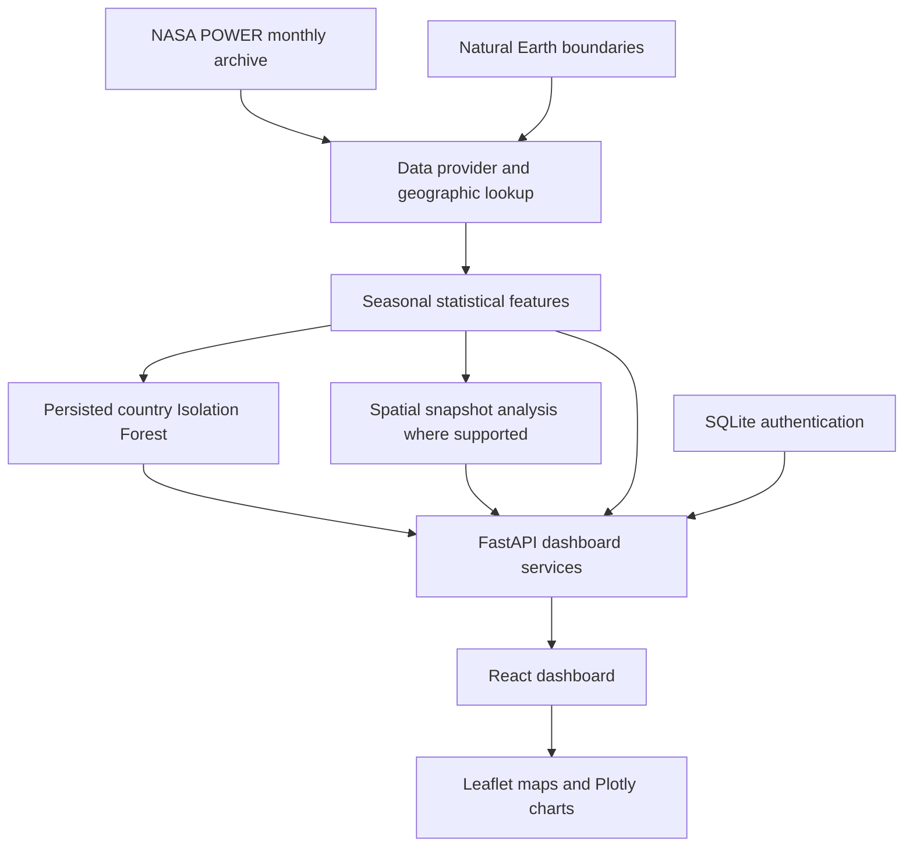

# Terra Signal | Earth System Trend Detective

**NASA Space Apps Challenge - Be An Earth System Trend Detective!**

An interactive Earth science dashboard that turns NASA's historical environmental data into understandable maps, seasonal comparisons and machine-learning anomaly insights.

    

[Source repository](https://github.com/sarujan-p/terra-signal) · [NASA POWER](https://power.larc.nasa.gov/) · [Training documentation](training/README.md) · [Model results](training/models/manifest.json) · [Screenshot walkthrough](#application-walkthrough--all-24-screenshots) · [Quick start](#quick-start)

> **Judge briefing:** Terra Signal is the project name; SAT-SCOPE is the name displayed in the current interface and API. This release uses real, bundled NASA POWER historical data, not simulated observations. It is an exploratory environmental analysis tool, not a live disaster warning system.


## At a glance

| Evidence | Scope |
|---|---|
| Historical archive | January 2011–December 2025 |
| Geographic sampling | 615 land grid locations, 5° spacing |
| Monthly records | 110,700 (615 × 180 months) |
| Environmental variables | Air temperature, precipitation, root-zone soil wetness |
| Persisted ML models | Australia, India, United Kingdom, United States |
| Model training / holdout | 3,312 / 2,208 observations |
| Recorded backend tests | 13 passed (see [test log](training/test-results.txt)) |
| Application evidence | 24 original screenshots below |

## Problem, solution and impact

Environmental observations are often difficult to interpret without specialist tools. Terra Signal makes historical NASA data accessible through a web dashboard that allows users to select a country or local administrative area, compare conditions against the same calendar month in a historical baseline, inspect unusual grid cells and explore changes over time.

The project addresses the challenge by combining temporal exploration with interpretable statistical indicators and multivariate anomaly detection. Its creative contribution is to connect temperature, rainfall and soil moisture rather than treating each measurement in isolation. A user can investigate whether unusual warmth, rainfall deficit and dry soil occur together, and inspect the individual signals behind a compound flag.

Potential benefits include climate education, exploratory drought and agricultural stress monitoring, and regional environmental research. The intended impact is to lower the barrier to using NASA data and support better-informed investigation, not to replace validated forecasts or professional risk assessments.

## Quick start

### 1. Install prerequisites

- [Git](https://git-scm.com/downloads)
- [Python 3.12](https://www.python.org/downloads/) (Python 3.11+ required for the pinned scikit-learn 1.8.0; use 3.12 for consistency)
- [Node.js](https://nodejs.org/) 22 LTS or another compatible supported release, with npm
- A normal computer; no GPU, NASA API key or external database is needed for the bundled archive.

### 2. Clone the repository

```bash
git clone https://github.com/sarujan-p/terra-signal.git
cd terra-signal
```

If using the ZIP release, extract it and open the `terra-signal-main` directory instead. Keep `backend`, `frontend`, `data` and `training` together at the root. Check that the historical JSON and four `.joblib` files are present before continuing.

### 3. Start the backend — terminal 1

**Windows PowerShell**

```powershell
cd backend
py -3.12 -m venv .venv
.\.venv\Scripts\Activate.ps1
python -m pip install --upgrade pip
python -m pip install -r requirements.txt
python -m uvicorn main:app --host 127.0.0.1 --port 8000
```

If PowerShell blocks activation, use the virtual environment interpreter directly:

```powershell
.\.venv\Scripts\python.exe -m pip install -r requirements.txt
.\.venv\Scripts\python.exe -m uvicorn main:app --port 8000
```

**Linux / macOS**

```bash
cd backend
python3.12 -m venv .venv
source .venv/bin/activate
python -m pip install --upgrade pip
python -m pip install -r requirements.txt
python -m uvicorn main:app --host 127.0.0.1 --port 8000
```

Verify [API health](http://127.0.0.1:8000/api/health) and [interactive API documentation](http://127.0.0.1:8000/docs). Keep this terminal running.

### 4. Start the frontend — terminal 2

Open a new terminal in the repository root.

```bash
cd frontend
npm install
npm run dev
```

Open **http://localhost:5173**. The default API address is `http://127.0.0.1:8000`. If you change the API address, copy `.env.example` to `.env` and set `VITE_API_URL`; restart Vite. For a separate deployed frontend, set backend `CORS_ORIGINS` to the actual frontend origin.

### 5. Sign in and explore

For a fresh **local** database, the bundled demo username is `sarujan` and password is `password`. Change it in Settings immediately before any public exposure. The password must have at least eight characters; changing it invalidates other sessions. The local SQLite database is created on startup at `data/sat_scope.sqlite`.

Select a country (e.g. United States of America), then Alaska or another sampled area. Inspect the overview, map, trends, indicator analysis, hotspots and methodology. Try Australia, India or the UK to see the other historical models. Unsampled areas explicitly report unavailable data.

### 6. Verify and troubleshoot

With the backend virtual environment active, run `python -m pytest -q` from `backend/`. From `frontend/`, run `npm run build` to produce `dist/`.

| Issue | Resolution |
|---|---|
| scikit-learn 1.8.0 cannot install | Use Python 3.11+; recreate the virtual environment with 3.12. Do not downgrade scikit-learn to load the saved models. |
| Cannot reach API | Start backend on port 8000; check `/api/health` and `VITE_API_URL`. |
| Browser CORS error | Match the frontend origin to `CORS_ORIGINS` (comma-separated). |
| No observations for selected area | Select a sampled area; missing coverage is not a software error. |
| Map background not loading | Internet access is needed for external map tiles; historical measurements are bundled. |
| Port already occupied | Stop the conflicting process or change the port and corresponding API/CORS configuration. |

## NASA data and preprocessing

| Parameter | Meaning | Unit | Analytical use |
|---|---|---|---|
| `T2M` | Air temperature at 2 m | °C | Seasonal Z-score |
| `PRECTOTCORR` | Corrected precipitation rate | mm/day | Historical percentile and transformed score |
| `GWETROOT` | Root-zone soil wetness | Dimensionless fraction | Percentage deviation from seasonal mean |

Source: [NASA POWER Monthly and Annual API](https://power.larc.nasa.gov/docs/services/api/temporal/monthly/), meteorological reanalysis derived from [MERRA-2](https://gmao.gsfc.nasa.gov/reanalysis/MERRA-2/). These are reanalysis values, not direct satellite imagery. The [archive](data/history/nasa_power_global_monthly_2011_2025.json) contains point samples, not national area averages. Natural Earth land, country and administrative boundaries provide geographic context.

The downloader selects land grid centers, requests monthly observations, retains cells with complete variables, and attaches geographic labels. Training organizes observations by cell and calendar month, computes baseline statistics using 2011–2020 only, and derives the three model features. The bundled archive is sufficient to run the app without downloading it again.

To regenerate the archive (network required, potentially lengthy):

```bash
cd backend
python scripts/download_nasa_power_history.py
```

The downloader supports checkpoints. Replacing the archive may change results; preserve the original for reproducibility.

## System architecture



The browser sends authenticated requests to FastAPI. The backend reads the archive, computes seasonal comparisons, applies the appropriate saved country model or spatial snapshot method, and returns indicator summaries, grid data and historical series. SQLite stores account and session-related security information; it is not the source of environmental observations.

## Scientific methodology and model evaluation

### Seasonal indicators

- **Temperature:** Z = (T − seasonal mean) / seasonal standard deviation. The training script uses population standard deviation and a 0.5 °C fallback for zero variance. Moderate/extreme thresholds are |Z| ≥ 2 / 3.
- **Soil wetness:** 100 × (W − seasonal mean) / |seasonal mean|; the training script returns zero when the baseline mean is zero. Drying thresholds of −5% and −15% are dashboard heuristics, not official drought categories.
- **Precipitation:** empirical percentile = 100 × (count below observation + 0.5 × count equal) / baseline count. The model feature is the inverse normal CDF of the percentile clipped to 0.5–99.5%. Dashboard deficit/extreme thresholds are 20th and 95th percentiles.

### Isolation Forest

Four separate pipelines use StandardScaler followed by IsolationForest (200 trees, contamination 0.08, random seed 42, n_jobs=1). The features are `z_temp`, `soil_delta_pct`, `z_rain`. Randomized trees isolate unusual observations; no labelled disaster dataset is required. The saved model predicts outliers and supplies an anomaly score; the dashboard's compound flag additionally requires at least two indicator flags. Driver descriptions are based on large standardized feature deviations, not causal explanations.

| Period | Purpose |
|---|---|
| 2011–2020 | Fit cell/month seasonal baselines |
| 2021–2023 | Fit scaler and Isolation Forest |
| 2024–2025 | Chronological holdout evaluation |

### Actual results from the bundled manifest

| Country | Cells | Fit rows | Holdout rows | Outliers | Holdout anomaly rate |
|---|---:|---:|---:|---:|---:|
| Australia | 30 | 1,080 | 720 | 53 | 7.36% |
| India | 12 | 432 | 288 | 11 | 3.82% |
| United Kingdom | 2 | 72 | 48 | 4 | 8.33% |
| United States of America | 48 | 1,728 | 1,152 | 119 | 10.33% |
| **Total** | **92** | **3,312** | **2,208** | **187** | **8.47%** |

Source: [manifest.json](training/models/manifest.json) and country holdout CSVs in [training/datasets](training/datasets/). Counts are derived from the saved holdout fractions and sample sizes. These are **model anomaly rates, not accuracy, precision, recall or confirmed disaster counts**. The 8% training contamination is a model setting, not a target holdout rate. The UK model is particularly exploratory because it has only two grid cells.

For other countries with observations, the app can use spatial snapshot Isolation Forest when sufficient cells exist (minimum 10); this is not a separately trained historical country model. Historical and snapshot scores should not be directly compared as calibrated risks. Sri Lanka has no sampled cell in the supplied archive.

## Application walkthrough - all 24 screenshots

The following original screenshots show the actual SAT-SCOPE interface included in this release. They are grouped in the order a judge can explore the application. Values shown are for the selected location and archive period, not current weather.

### Access and overview

#### 01. Sign-in

Enter the local demo credentials to access the authenticated dashboard.


#### 02. Country overview

The United States overview summarizes archive status and environmental indicator cards; the banner reminds users to change the default password.


#### 03. Country selection

Open the country selector to switch geographic context, including Global and individual countries.


#### 04. Administrative-area selection

Use the dependent area selector to narrow the chosen country to a state or other local area.


#### 05. Alaska overview

Selecting Alaska updates the indicator cards to the selected area; temperature, soil wetness and precipitation are displayed alongside unavailable fire data.


### Geographic exploration

#### 06. Interactive observation map

Inspect sampled Alaska grid points on the standard map. The signal panel summarizes unusual conditions and the legend explains the map markers.


#### 07. Satellite imagery basemap

Switch the background to satellite imagery for geographic context. This imagery is a visualization layer, not an input to the trained models.


### Historical time series

#### 08. Temperature trend

The orange series shows monthly air temperature for the selected area and supports comparison with historical seasonal conditions.


#### 09. Soil wetness trend

The green series shows root-zone soil wetness over the selected time window.


#### 10. Precipitation trend

The blue series shows monthly corrected precipitation rates and their variation over the selected period.


#### 11. Extended precipitation history

A longer chart window exposes repeated wet and dry cycles and allows comparison across years.


#### 12. Longer-term precipitation exploration

The extended series makes multi-year variability visible. Visual changes are not a formal statistical trend significance test.


### Indicator heatmaps

#### 13. Temperature heatmap

The map highlights the selected area and the accompanying panel reports a temperature Z-score (approximately −2.37 in this screenshot).


#### 14. Soil wetness heatmap

The green highlighted area and deviation panel show the selected region’s soil wetness comparison (approximately +6.3%).


#### 15. Precipitation heatmap

The rainfall panel shows a historical percentile of approximately 17.9 for the selected area, supporting investigation of rainfall deficit.


#### 16. Fire data availability

The fire panel explicitly reports Unavailable because historical fire detections are not included. Missing data are not treated as zero fires.


### Detailed analysis and hotspots

#### 17. Indicator analysis page

Open the indicator analysis view to inspect individual environmental measurements and their status.


#### 18. Four indicator cards

The detailed cards show −22.5 °C air temperature, 0.902 root-zone soil wetness, 0.9 mm/day precipitation and unavailable fire observations for the displayed selection.


#### 19. Regional hotspot ranking

The hotspot table compares regional signals and provides a starting point for investigating unusual conditions.


#### 20. Unusual grid cells

Scroll to the cell-level table to inspect anomaly scores and plain-language driver descriptions for the selected area.


### Methodology and settings

#### 21. Detection methodology

The methodology page identifies the historical country Isolation Forest and explains the seasonal statistical methods.


#### 22. Method details and limitations

The remaining methodology panels explain rainfall quantiles, the fire clustering method retained for future data, compound anomaly detection and the archive limitations.


#### 23. Account settings

The settings page provides account information and password-change controls. Replace the local default credentials before deployment.


#### 24. Data-source transparency

The data-source table identifies the archive-backed variables and availability, allowing users to verify provenance and distinguish missing fire data.


## Suggested five-minute judge demonstration

1. Sign in locally and show the NASA archive status on the overview.
2. Select United States of America → Alaska; explain the three indicators and unavailable fire data.
3. Open the observation map, switch basemaps and inspect a sampled grid point.
4. Compare temperature, soil wetness and rainfall charts; switch between shorter and longer monthly windows.
5. Open Hotspots and Methodology; explain the difference between individual signals, compound flags and historical versus snapshot inference.
6. Show the model manifest, holdout CSVs and notebooks; explain why anomaly rate is not accuracy.

## Reproduce the models and notebooks

From the repository root, with the backend virtual environment activated:

```bash
python training/train.py
```

This regenerates the feature CSV, seasonal baselines, four holdout CSVs, four Joblib models and manifest. The existing saved models are sufficient for normal dashboard inference; retraining is optional. Only load trusted Joblib artifacts.

| Notebook | Country |
|---|---|
| [01_Australia_Model.ipynb](training/notebooks/01_Australia_Model.ipynb) | Australia |
| [02_India_Model.ipynb](training/notebooks/02_India_Model.ipynb) | India |
| [03_United_Kingdom_Model.ipynb](training/notebooks/03_United_Kingdom_Model.ipynb) | United Kingdom |
| [04_United_States_of_America_Model.ipynb](training/notebooks/04_United_States_of_America_Model.ipynb) | United States |

Install Jupyter with `python -m pip install jupyter matplotlib` and launch `jupyter notebook` from the project root. Open the notebook and run its cells with the backend environment. For Colab or Kaggle, upload/extract the repository and preserve the relative dataset paths; install the pinned dependencies before execution. No separately hosted notebook execution is claimed.

## Repository structure

```text
terra-signal/
├── README.md
├── LICENSE
├── backend/
│   ├── main.py                 # FastAPI entry point
│   ├── config.py               # Paths, thresholds, CORS
│   ├── data_provider.py        # Historical archive access
│   ├── ml/                     # Statistics and anomaly inference
│   ├── routers/                # Authentication and data endpoints
│   ├── services/               # Dashboard, caching, security
│   ├── scripts/                # NASA archive downloader
│   ├── tests/                  # Backend tests
│   └── requirements.txt
├── frontend/
│   ├── src/                    # React UI, maps, charts, API client
│   ├── package.json
│   └── vite.config.js
├── data/history/               # NASA JSON and Natural Earth boundaries
├── training/
│   ├── train.py
│   ├── datasets/               # Features and holdout predictions
│   ├── models/                 # Four pipelines, baselines, manifest
│   ├── notebooks/              # Four country notebooks
│   └── test-results.txt
└── screenshots/                # 1.png through 24.png
```

## API reference

Base URL: `http://127.0.0.1:8000`. Interactive docs: `/docs`. Data endpoints require `Authorization: Bearer <token>`; obtain a token from login. Health and login are public.

| Method | Path | Purpose |
|---|---|---|
| GET | `/api/health` | Service health |
| POST | `/api/auth/login` | Sign in |
| GET | `/api/auth/me` | Account details |
| POST | `/api/auth/change-password` | Change password |
| GET | `/api/locations` | Country/area options |
| GET | `/api/map/countries` | Country boundaries |
| GET | `/api/map/areas/{country}` | Administrative boundaries |
| GET | `/api/dashboard/{location}` | Dashboard data and model method |
| GET | `/api/temperature/{location}` | Temperature analysis |
| GET | `/api/vegetation/{location}` | Legacy route name; archive soil wetness |
| GET | `/api/precipitation/{location}` | Rainfall analysis |
| GET | `/api/fire/{location}` | Fire availability |
| GET | `/api/cache/{location}` | Cached dashboard information |
| GET | `/api/data-source` | Data provenance |
| POST | `/api/data/refresh` | Refresh archive-backed results |

Use location IDs returned by `/api/locations`. Refreshing does not fetch live NASA observations in this archive-only release.

## Technologies and resources

| Area | Resources |
|---|---|
| NASA | [POWER](https://power.larc.nasa.gov/), [Monthly API](https://power.larc.nasa.gov/docs/services/api/temporal/monthly/), [MERRA-2](https://gmao.gsfc.nasa.gov/reanalysis/MERRA-2/) |
| Geography | [Natural Earth](https://www.naturalearthdata.com/), [OpenStreetMap](https://www.openstreetmap.org/copyright), [Esri World Imagery](https://server.arcgisonline.com/ArcGIS/rest/services/World_Imagery/MapServer) |
| Frontend | [React](https://react.dev/), [Vite](https://vite.dev/), [Leaflet](https://leafletjs.com/), [React Leaflet](https://react-leaflet.js.org/), [Plotly](https://plotly.com/javascript/), [Axios](https://axios-http.com/), [Lucide](https://lucide.dev/) |
| Backend | [Python](https://www.python.org/), [FastAPI](https://fastapi.tiangolo.com/), [Uvicorn](https://www.uvicorn.org/), [SQLite](https://www.sqlite.org/), [Pydantic](https://docs.pydantic.dev/), [PyJWT](https://pyjwt.readthedocs.io/) |
| Science | [NumPy](https://numpy.org/), [Pandas](https://pandas.pydata.org/), [SciPy](https://scipy.org/), [scikit-learn](https://scikit-learn.org/), [Joblib](https://joblib.readthedocs.io/) |
| Development | [Jupyter](https://jupyter.org/), [GitHub](https://github.com/), [pytest](https://docs.pytest.org/), [HTTPX](https://www.python-httpx.org/), [Node.js](https://nodejs.org/), [npm](https://www.npmjs.com/) |

Algorithm reference: [Isolation Forest, Liu, Ting & Zhou (2008)](https://doi.org/10.1109/ICDM.2008.17). See [scikit-learn documentation](https://scikit-learn.org/stable/modules/generated/sklearn.ensemble.IsolationForest.html).

## Design decisions, limitations and future work

- Scientific integrity: real NASA archive only; no simulated observations or live fallback. Missing values and unsampled areas are explicitly unavailable.
- Seasonal comparability: same-cell, same-month baselines reduce seasonal confounding; chronological splits prevent future observations entering baseline/model fitting.
- Geographic limits: 5° point sampling is coarse, not city-level or national area coverage. The UK has two cells; Sri Lanka has none.
- Temporal limits: monthly observations cannot resolve daily extremes. The seven-day chart option is disabled for monthly data. Historical charts show variation, not formal fitted trend slopes or significance tests.
- Validation limits: unsupervised scores are not calibrated probabilities or causal explanations; independent event validation is needed.
- Product scope: no historical MODIS NDVI/LST, GPM IMERG or FIRMS fire data are included. Soil wetness is not NDVI. Fire DBSCAN code is retained for future real observations, not a validated fire model.
- Future work: higher-resolution sampling, formal trend estimation and significance testing, additional country models, independent event validation and real satellite product integration.
- Deployment: this ZIP is a local two-service application. Public hosting requires configuring frontend API URL, CORS, HTTPS, secure credentials and persistent account storage. The intended domain is `terrasignal.earth`; public availability is not verified here. No cloud deployment is required for the local demo.

## Verification and acknowledgements

The supplied [test log](training/test-results.txt) records 13 backend tests passing in 8.38 seconds. The frontend production build was not verified in the original packaging environment; run the build locally as described above. Screenshots document the application interface, not independent scientific validation.

Thanks to NASA Langley Research Center's POWER Project, NASA's MERRA-2 team, Natural Earth, OpenStreetMap contributors, Esri and the open-source software communities. Preserve map attributions and third-party license notices. ChatGPT assisted with development and documentation. Project source code is provided under the [MIT License](LICENSE); third-party datasets and imagery retain their own terms.

**Terra Signal - making Earth's historical environmental signals easier to explore, understand and investigate.**
